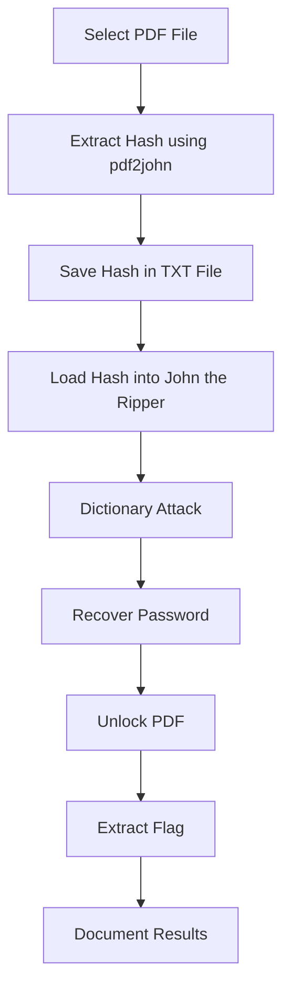
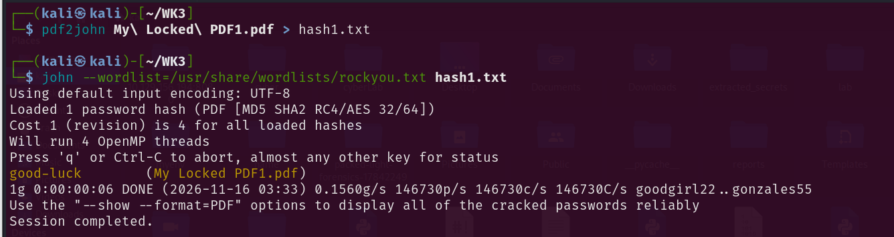
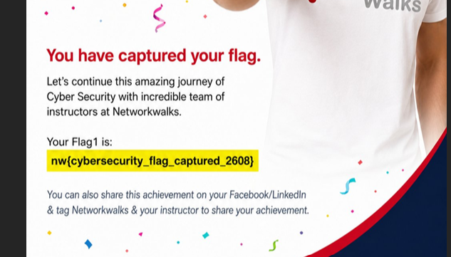
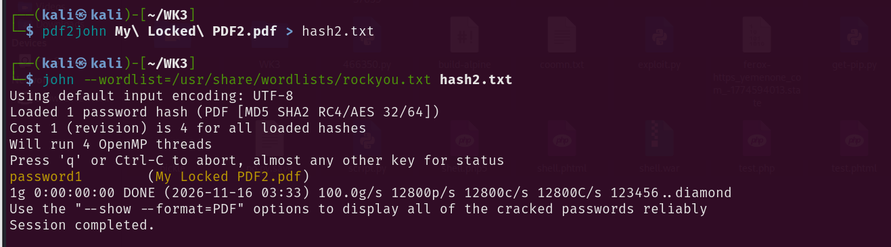
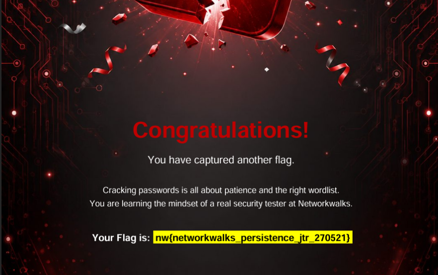
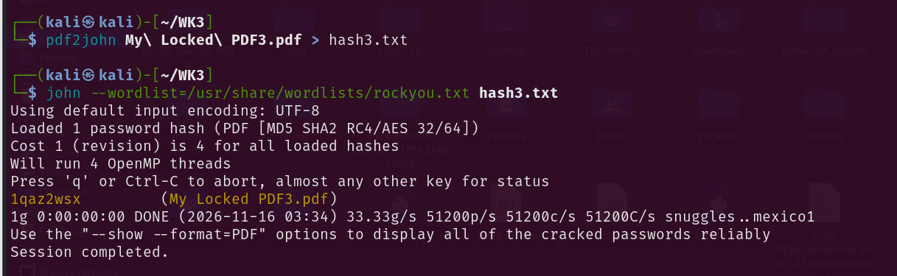
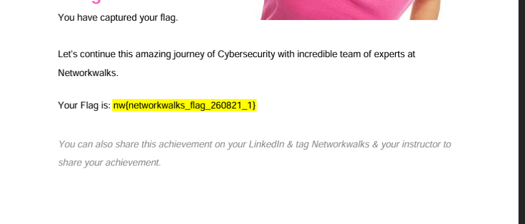
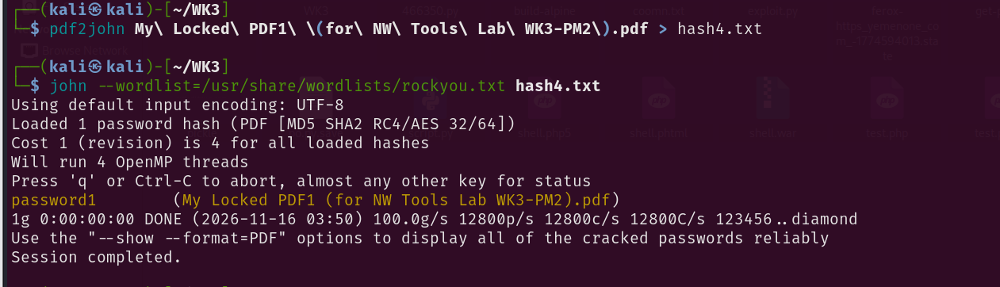
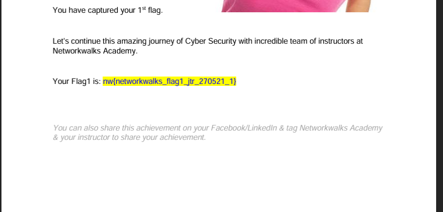

# Password Cracking & Hash Extraction
### NetworkWalks Cybersecurity Program — Week 3

---

## 1. Introduction

This report documents the practical implementation of password cracking techniques as part of Week 3 of the NetworkWalks Cybersecurity Program (Batch B082).

The main objective of this lab was to recover passwords from four password-protected PDF files, extract their corresponding flags, and understand how dictionary-based password attacks work in practice.

The practical work focused on **John the Ripper (JtR)**. The process involved extracting password hashes from PDF files and then using John the Ripper to identify the original passwords.

## 2. Lab Objectives

- Understand the difference between encryption and hashing.
- Learn how password hashes are extracted from protected PDF documents.
- Practice using John the Ripper for dictionary-based password attacks.
- Recover passwords from four protected PDF files.
- Verify each recovered password by opening its corresponding PDF.
- Extract and document the flag contained in each file.

## 3. Lab Environment & Tools

The following environment and tools were used during the practical exercises.

| Component | Details |
|---|---|
| Operating System | Kali Linux  |
| Hash Extraction Tool | pdf2john |
| Password Cracking Tool | John the Ripper |
| Attack Method | Dictionary Attack |
| Target Files | 4 Password-Protected PDF Files |
| Virtualization | VMware  |

## 4. Theoretical Background

### 4.1 Encryption vs. Hashing

**Encryption:** A reversible cryptographic process that protects data using a key. The original information can be recovered through decryption with the appropriate key.

**Hashing:** A one-way mathematical function that transforms input data into a fixed-format hash value. Password cracking tools do not directly decrypt hashes; instead, they test candidate passwords and compare the resulting values against the target hash.

### 4.2 Dictionary Attack

A dictionary attack is a password-cracking technique that uses a predefined list of candidate passwords (Wordlist).

John the Ripper tests these candidates against the extracted password hash until a matching password is identified.

## 5. Attack Methodology

The same general methodology was applied to each of the four PDF files.

### Workflow Diagram




### 5.1 Hash Extraction

Before starting the cracking process, the password hash was extracted from each protected PDF file using `pdf2john`.

The following command was used:

```bash
pdf2john "filename.pdf" > hash.txt
```

**Command explanation:**

- `pdf2john`: Extracts the password-related hash information from a protected PDF.
- `filename.pdf`: The target PDF file.
- `>`: Redirects the extracted output into a text file.
- `hash.txt`: Stores the extracted hash for the next step.


### 5.2 Password Cracking with John the Ripper

After extracting the hash, John the Ripper was used to perform a dictionary attack.

The extracted hash file was supplied to John along with the selected wordlist.

```bash
john --wordlist=/usr/share/wordlists/rockyou.txt hash1.txt
```

**Command explanation:**

- `john`: Starts John the Ripper.
- `--wordlist`: Specifies the wordlist used for the attack.
- `/usr/share/wordlists/rockyou.txt`: The path to the selected wordlist.
- `hash1.txt`: The file containing the extracted PDF hash.

After the attack completed, the recovered password could be displayed using:

```bash
john --show hash1.txt
```


### 5.3 Password Verification & Flag Extraction

Once John the Ripper recovered the password, it was used to open the corresponding protected PDF file.

The document was then inspected to locate and extract its flag.


---

# 6. Practical Implementation

This section documents the practical execution for each of the four target PDF files.

The same extraction and cracking methodology was applied independently to every file.

## 6.1 File 1 — My Locked PDF1.pdf

**Step 1: Hash Extraction**

The first PDF file was processed using `pdf2john` to extract its password hash.

```bash
pdf2john "My Locked PDF1.pdf" > hash1.txt
```

**Step 2: Password Cracking**

The extracted hash was loaded into John the Ripper, and a dictionary attack was executed.

```bash
john --wordlist=/usr/share/wordlists/rockyou.txt hash1.txt
```




**Step 3: Password Verification & Flag Extraction**

The recovered password was used to unlock the PDF and access its contents.




---

## 6.2 File 2 — My Locked PDF2.pdf

**Step 1: Hash Extraction**

```bash
pdf2john "My\ Locked\ PDF2.pdf" > hash2.txt
```


**Step 2: Password Cracking**

```bash
john --wordlist=/usr/share/wordlists/rockyou.txt hash2.txt
```




**Step 3: Password Verification & Flag Extraction**

The recovered password was used to open the second PDF and retrieve its flag.




---

## 6.3 File 3 — MY Locked PDF3.pdf

**Step 1: Hash Extraction**

```bash
pdf2john "My\ Locked\ PDF3.pdf" > hash3.txt
```


**Step 2: Password Cracking**

```bash
john --wordlist=/usr/share/wordlists/rockyou.txt hash3.txt
```




**Step 3: Password Verification & Flag Extraction**

The recovered password was used to unlock the third PDF and retrieve its flag.




---

## 6.4 File 4 — "My Locked PDF1 (for NW Tools Lab WK3-PM2).pdf

**Step 1: Hash Extraction**

```bash
pdf2john "My\ Locked\ PDF1\ \(for\ NW\ Tools\ Lab\ WK3-PM2\).pdf" > hash4.txt
```


**Step 2: Password Cracking**

```bash
john --wordlist=/usr/share/wordlists/rockyou.txt hash4.txt
```




**Step 3: Password Verification & Flag Extraction**

The recovered password was used to unlock the fourth PDF and retrieve its flag.




---

# 7. Final Results Summary

The following table provides a consolidated overview of the results obtained from the four PDF files.

| # | PDF File | Recovered Password | Extracted Flag | Status |
|---|---|---|---|---|
| 1 | (My Locked PDF1.pdf) | (good-luck) | (nw{cybersecurity_flag_captured_2608}) | (Success) |
| 2 | (My Locked PDF2.pdf) | (Password1) | ( nw{networkwalks_persistence_jtr_270521}) | (Success) |
| 3 | (My Locked PDF3.pdf) | (1qaz2wsx) | ( nw{networkwalks_flag_260821_1}) | (Success) |
| 4 | (My Locked PDF1 (for NW Tools Lab WK3-PM2).pdf) | (Password1) | ( nw{networkwalks_flag1_jtr_270521_1}) | (Success) |

**Total Target Files:** 4

**Successfully Recovered Passwords:** 4

**Successfully Extracted Flags:** 4

---

# 8. Security Analysis & Lessons Learned

This practical exercise demonstrated how password-protected PDF documents can be vulnerable when weak or commonly used passwords are selected.

The main lessons learned include:

- **Weak Passwords:** Common and predictable passwords can be discovered through dictionary attacks.
- **Hash Extraction:** Understanding how to extract password hashes is an essential step in offline password auditing.
- **Dictionary Attacks:** Wordlists can significantly reduce the time required to identify weak passwords.
- **Password Strength:** Longer and less predictable passwords provide stronger resistance against dictionary-based attacks.
- **Security Awareness:** Password protection alone should not be considered sufficient if weak passwords are used.

## 9. Conclusion

During this lab, I successfully practiced the process of extracting password hashes from four protected PDF documents and performing dictionary-based password attacks using John the Ripper.

The exercise provided practical experience in hash extraction, password recovery, and flag verification.

It also reinforced the importance of using strong, unique passwords and understanding the security risks associated with weak password selection.

---

## 10. References & Tools

- [John the Ripper — Official Website](https://www.openwall.com/john/)
- [John the Ripper — GitHub Repository](https://github.com/openwall/john)
- [NetworkWalks](https://networkwalks.com/)
- `pdf2john` — PDF password hash extraction utility.

---

**Author:** Mohammed Sami  
**Program:** NetworkWalks Cybersecurity Program  
**Batch:** B084
**Module:** Week 3 — Password Cracking & Hashing Fundamentals
